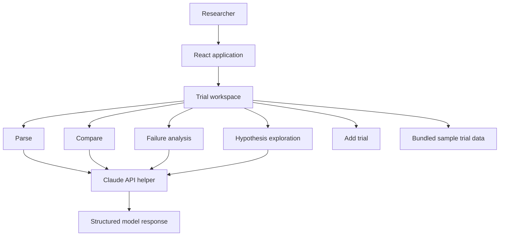

# Neurotrial

[](https://github.com/CHARITHA6969/neurotrial/actions/workflows/neurotrial-ci.yml)

**A React + FastAPI prototype for exploring LLM-assisted neuroscience clinical-trial intelligence.**

Neurotrial explores a researcher-oriented workflow for inspecting clinical-trial records, comparing studies, identifying reported failure factors, and developing hypotheses for further investigation.

> **Project status:** Frontend prototype / experimental integration. The current app uses explicitly synthetic demonstration records and a direct browser-to-Anthropic API call behind an API-key gate. It is not a validated clinical research tool and must not be used to make medical, treatment, or investment decisions.

## Problem space

Clinical-trial information is distributed across structured records and scientific documents. Researchers may need to compare study designs, populations, interventions, endpoints, and reported outcomes before forming a useful view of the evidence.

Neurotrial is an exploration of how an LLM interface might help organize this work while preserving a distinction between source facts and model-generated interpretation.

## Current capabilities in the interface

- **Parse:** inspect a trial and request a structured analysis.
- **Compare:** examine multiple trials side by side.
- **Failure analysis:** explore factors associated with unsuccessful or terminated trials.
- **Hypotheses:** develop possible explanations or research questions from the available information.
- **Add trial:** add a trial record to the current in-memory session.
- **Sample dataset:** load fictional demonstration scenarios from the local application data; these are not real clinical trials or source evidence.

The interface is organized into reusable React components and separate analysis tabs.

## Architecture today



This diagram describes the current prototype, not a production architecture. The React client now sends prompts to a FastAPI gateway. The gateway reads the Anthropic key from its server environment; it does not accept provider keys from the browser. The bundled records are synthetic scenarios and must not be cited as clinical evidence.

## Technology

- **Frontend:** React 18
- **Backend:** Python, FastAPI, HTTPX
- **Provider security:** server-side environment secret, prompt-size validation, provider timeout, restricted CORS
- **Language:** JavaScript / JSX
- **LLM integration experiment:** Anthropic Messages API
- **Automated tests:** Jest via Create React App (response parsing and provider error handling)
- **Data:** local sample trial records
- **UI structure:** reusable components, tab-based workflows, shared style tokens

## Repository structure

```text
neurotrial/
├── backend/\n│   ├── app/main.py\n│   ├── tests/test_api.py\n│   ├── requirements.txt\n│   └── Dockerfile\n├── public/
├── src/
│   ├── api/
│   │   └── claude.js
│   ├── components/
│   │   ├── tabs/
│   │   │   ├── ParseTab.jsx
│   │   │   ├── CompareTab.jsx
│   │   │   ├── FailureTab.jsx
│   │   │   ├── HypothesisTab.jsx
│   │   │   └── CustomTab.jsx
│   │   ├── ApiKeyGate.jsx
│   │   ├── Header.jsx
│   │   └── Sidebar.jsx
│   ├── data/
│   │   └── sampleTrials.js
│   ├── styles/
│   └── App.jsx
└── package.json
```

## Run locally

Prerequisites: Node.js and npm.

```bash
npm install
npm start
```

The development server starts at [http://localhost:3000](http://localhost:3000).\n\nStart the backend in a second terminal:\n\n```bash\ncd backend\npython -m venv .venv\n# Activate the environment, then install dependencies:\npip install -r requirements.txt\n# Configure ANTHROPIC_API_KEY in this server environment.\nuvicorn app.main:app --reload\n```\n\nSet `REACT_APP_API_URL` only if the backend is not at `http://localhost:8000`. The browser no longer receives or stores an Anthropic API key.

Create a production build:

```bash
npm run build
```

Run API-helper tests:

```bash
npm test -- --watchAll=false
```

The frontend tests cover JSON parsing, malformed output, server-proxy request construction, and backend errors. Backend tests cover health, missing server credentials, and invalid/oversized prompts.

## Important security and research limitations

- **Do not use real patient data or confidential research data** with this prototype.
- The backend proxy reads `ANTHROPIC_API_KEY` from its runtime environment. The current service still needs authentication, per-user quotas, rate limiting, audit controls, and managed secret storage before public deployment.
- All bundled trial records are synthetic demonstration scenarios, not real trials, registry records, or validated research data. Their IDs and scientific details must not be cited.
- LLM-generated outputs can be incomplete or incorrect. Every claim, number, endpoint, and outcome must be checked against the original trial source.
- Hypotheses are exploratory suggestions, not established scientific conclusions.
- Trial status, failure reasons, and outcome definitions require careful source-specific interpretation.

The analysis prompt is designed to discourage fabricated trial facts, separate facts from inferences, and flag uncertainty. This is a useful guardrail, not a substitute for evidence retrieval, citations, or expert review.

See [Data provenance and research integrity](docs/data-provenance.md) and [Security model and deployment boundary](docs/security-model.md) for explicit requirements and current limitations.

## Roadmap

1. Add authentication, per-user quotas, rate limiting, and request audit controls to the backend API.
2. Ingest source records with stable identifiers and provenance.
3. Add retrieval with source-level citations for every extracted claim.
4. Define typed schemas and validate all model responses; the shared JSON-object parser now rejects malformed and non-object output.
5. Build evaluation cases for extraction accuracy, comparison consistency, and unsupported claims.
6. Add error handling, request tracing, tests, and CI.
7. Add human review and exportable research notes with links to source records.

## Design principles

- Evidence before interpretation.
- Explicit separation of facts, inferences, and hypotheses.
- Source traceability for important claims.
- Clear uncertainty when the source does not support a conclusion.
- Human review for scientific decisions.

---

Neurotrial is an engineering prototype for responsible AI-assisted research workflows. Feedback and contributions are welcome.
