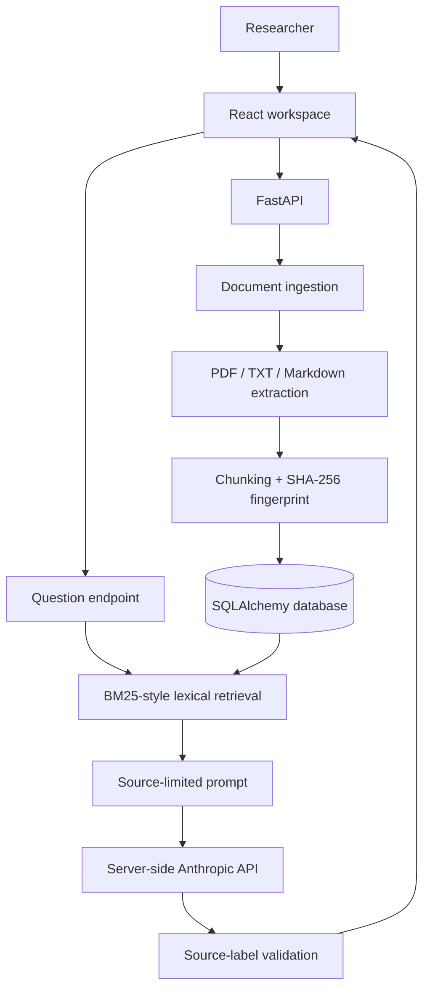

# Neurotrial architecture

Neurotrial is a single-user research prototype for source-document ingestion and source-aware LLM-assisted analysis.

## System context

## Ingestion flow

1. The API accepts PDF, TXT, and Markdown uploads with an 8 MB size ceiling.
2. The filename is reduced to its basename before persistence.
3. PDF text is extracted with pypdf; text documents must be UTF-8.
4. Text is normalized and divided into overlapping chunks.
5. The source document and its chunks are persisted with a SHA-256 fingerprint.

## Question-answering flow

1. The researcher submits a question and optional document IDs.
2. The BM25-style lexical retriever filters common stop words and scores candidate chunks using term frequency, inverse document frequency, and passage-length normalization.
3. The API constructs a prompt containing retrieved excerpts and explicit source labels.
4. The server calls the configured Anthropic API; provider credentials remain server-side.
5. The API checks that any generated `[S#]` label maps to one of the retrieved excerpts.
6. The response includes the answer and source metadata with excerpts.

## Retrieval and citation boundaries

The BM25-style retriever is deterministic and inspectable, but it is lexical rather than semantic. It can miss paraphrases and conceptually related terms that do not share tokens.

Checking citation labels prevents fabricated source IDs. It does not prove that a cited passage entails a claim or that every claim is properly cited. Those require a curated evaluation set and human review.

## Security and research boundaries

- The API key must be configured only in the backend environment.
- The current document service has no user authentication or per-user document ownership.
- Do not upload patient-identifiable or confidential data.
- Rate limits, malware scanning, private object storage, access isolation, audit logging, semantic retrieval, and citation-entailment evaluation remain future work.
- This is a research prototype, not clinical decision support.
